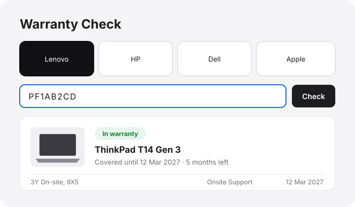

<p align="center"></p>

<h1 align="center">Warranty Check</h1>

<p align="center">Check a laptop's warranty from its serial number in about a second, without clicking through the brand's support site.<br>Handy when you buy second-hand laptops.</p>

<p align="center"></p>

## What it does

| Brand | Result |
|---|---|
| **Lenovo / ThinkPad** | Instant: in or out of warranty, every coverage line with dates, product picture, build, ship and purchase dates |
| **HP** | Confirms the exact model from the serial, then one click to HP's warranty page (HP hides the dates behind a captcha) |
| **Dell** | Shows the Service Tag and its Express Service Code (what Dell support asks for), then one click to Dell's warranty page (Dell blocks direct lookups) |
| **Apple** | Shows the exact model and the month it was made (12-character serials, 2010-2020), then one click to Apple's coverage page with the serial copied (Apple requires a captcha) |

Extras: it guesses the brand from the serial's shape, keeps your recent checks, has a "Copy summary" button for sending to a seller, and links like `?brand=lenovo&serial=PF1AB2CD` open straight on the result. "Where do I find the serial?" shows the one-line command for Windows and Linux.

## Languages

The page speaks 21 languages: English, French, Spanish, German, Italian, Portuguese, Dutch, Polish, Swedish, Czech, Romanian, Turkish, Russian, Ukrainian, Arabic (right to left), Hindi, Chinese, Japanese, Korean, Indonesian and Vietnamese. First-time visitors are sent to their browser's language; the globe menu in the footer switches it. Dates, durations ("13 months left") and countries are formatted by the browser for that language.

Each language is a real page (`/fr/`, `/de/`, ...) with its own title, description, keywords and FAQ, linked with `hreflang` so search engines show the right one.

## Search engines and AI assistants

Every page has a canonical link, Open Graph and Twitter cards with a share image, and schema.org `WebApplication` + `FAQPage` data. `sitemap.xml` lists every language, `robots.txt` welcomes search and AI crawlers, and `llms.txt` describes the tool for AI assistants.

## Editing

The pages are generated. Change `src/page.html` (layout) or `src/i18n/<lang>.json` (text), then run:

```bash
SITE_URL=https://your-domain.example python3 build.py
```

Adding a language is one new JSON file with the same keys as `en.json`; the build refuses missing keys.

## Run it on the web (Vercel)

The repo deploys to Vercel as is: `public/` is the page, `api/` holds the Python functions that call the brands. Import the repo on [vercel.com/new](https://vercel.com/new) or run `npx vercel --prod`.

## Run it on your own computer (Linux)

```bash
./install.sh     # adds the `warranty` command and an app-grid launcher
warranty         # starts the local server on 127.0.0.1:8765 and opens the page
```

Locally, **Detect this computer** reads this machine's brand and serial (through `pkexec`) and checks it.

## Detect this computer, online

Browsers never let a website read a computer's serial number, so the online button does the closest thing:

- **Windows:** it downloads `Warranty Check.cmd` (built per language into `public/detect/`). Opening it reads the brand, model and serial with PowerShell and reopens the site with `?vendor=…&model=…&serial=…`, which checks it straight away. Nothing is installed. Windows SmartScreen may ask for *More info → Run anyway* the first time.
- **Mac:** Apple is picked automatically and the page says where the serial is (Apple menu → About This Mac).
- **Linux:** it opens the "Where's the serial?" panel.
- **Phones and tablets:** the button is hidden, since you're usually checking another computer.
Only Python's standard library is needed.

## Why a server?

Browsers refuse to call another site's API from a web page (CORS), so a small backend makes the request: the Vercel functions online, `warranty_server.py` locally. Both use the same code in `api/_core.py`.

Lenovo's lookup uses the same JSON endpoint as Lenovo's own support site. These endpoints are unofficial and can change.

## Credits

Logos from [Simple Icons](https://simpleicons.org) (CC0). Brand names and logos belong to their owners; this project isn't affiliated with any of them.

## License

MIT. Made by [eNamia](https://www.enamia.eu).
